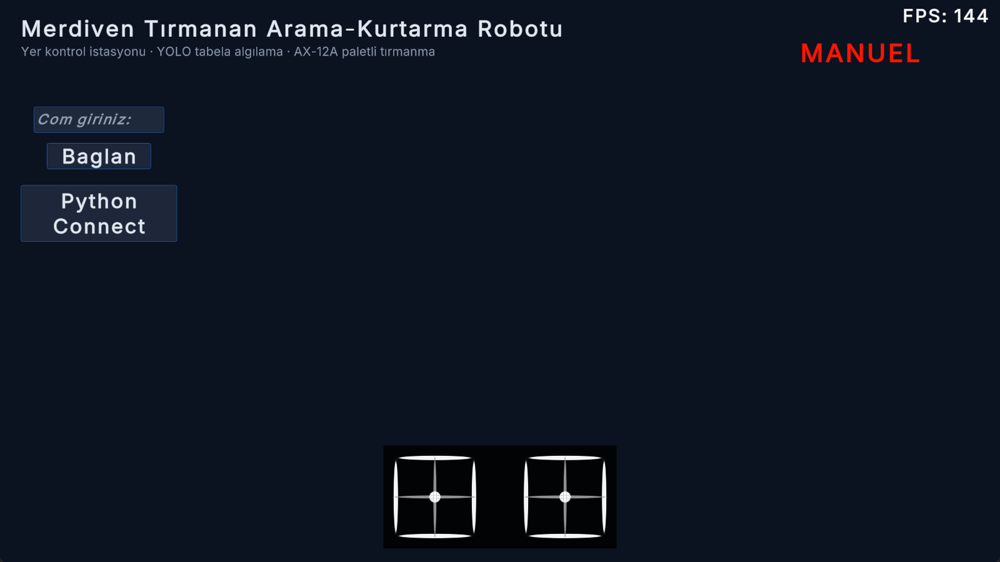
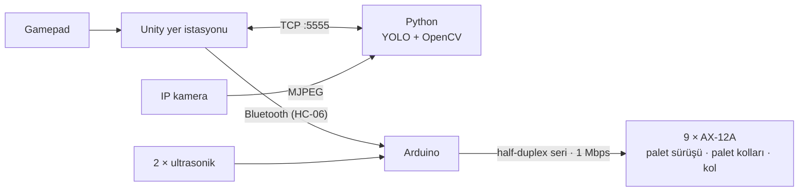

# 🪜 Merdiven Tırmanan Arama-Kurtarma Robotu

**Afet senaryosu için merdiven inip çıkabilen, kamerayla tabela ve renk algılayan, Unity yer istasyonundan yönetilen paletli robot**

## Proje hakkında
Bina içi arama-kurtarma görevinde robotun şunları yapması gerekiyordu:
- merdiven çıkıp inmek,
- kat içinde ilerlemek,
- **doğalgaz vanası**, **merdiven inişi** ve **toplanma alanı** tabelalarını bulmak,
- renkli işaretleri tanımak.

Robotun mekanik hareket yazılımını, görüntü işleme tarafını ve yer istasyonunu geliştirdim.

## Özellikler
- **9 Dynamixel AX-12A akıllı servo:** 4'ü sürekli dönüş modunda paletleri sürer, 4'ü palet kollarının açısını ayarlar, 1'i kolu hareket ettirir.
- **Merdiven tırmanma ve inme**
  - Önde ve altta birer ultrasonik sensör basamağa olan mesafeyi ölçer.
  - Bu ölçümle önceden ayarlanmış tırmanma ve iniş hareket dizileri tetiklenir.
- **Manuel sürüş:** Gamepad komutları Unity'den Bluetooth'a (HC-06) gider, robot palet ve kol hareketlerini uygular.
- **Görüntü işleme (Python)**
  - IP kamera yayını üzerinde **kendi eğittiğim YOLO modeli** ile 3 tabela sınıfı algılanır. Yalnızca %75'in üzerindeki güven skorları kabul edilir.
  - HSV maskeleriyle mavi, kırmızı, yeşil ve sarı renk işaretleri tanınır.
- **Unity ↔ Python köprüsü:** Yer istasyonu, TCP soketi (127.0.0.1:5555) üzerinden algılama modunu başlatır ve sonuçları alır.

## Mimari

## Nasıl denenir
1. [Releases](../../releases) sayfasından `StairClimbingRobot-Windows.zip` dosyasını indirip `StairClimbingRobot.exe` ile yer istasyonunu aç.
2. Robot bağlıysa Bluetooth COM numarasını girip **Bağlan**'a bas.
3. Görüntü işleme tarafı için [`showcase/vision/sign_detection.py`](showcase/vision/sign_detection.py) çalıştırılıp ardından **Python Connect** ile bağlanılır.

> Eğitilmiş model ağırlıkları ve veri seti repoya dahil değildir.

## Kod örnekleri
- [`firmware/merdiven_cikan/cikis.ino`](showcase/firmware/merdiven_cikan/cikis.ino) ve [`inis.ino`](showcase/firmware/merdiven_cikan/inis.ino): sensöre bağlı tırmanma ve iniş dizileri.
- [`firmware/merdiven_cikan/manuel.ino`](showcase/firmware/merdiven_cikan/manuel.ino): Bluetooth komut paketinin çözümü ve manuel sürüş.
- [`vision/sign_detection.py`](showcase/vision/sign_detection.py): YOLO ve HSV ile algılama, Unity ile soket iletişimi.
- [`unity/python_iletisim.cs`](showcase/unity/python_iletisim.cs): Unity tarafındaki TCP istemcisi.

## Neler öğrendim
- Özel bir nesne algılama modeli eğitip gerçek zamanlı bir robota entegre etmek.
- Farklı dillerde yazılmış süreçler arasında (C#, Python ve gömülü C++) haberleşme kurmak.
- Tek bir half-duplex hat üzerinden 9 akıllı servoyu (Dynamixel) koordineli yöneterek çok eklemli hareket dizileri tasarlamak.

---
© Ahmet Emin Arslanbaş — Tüm hakları saklıdır. Kod inceleme amaçlı paylaşılmıştır.
